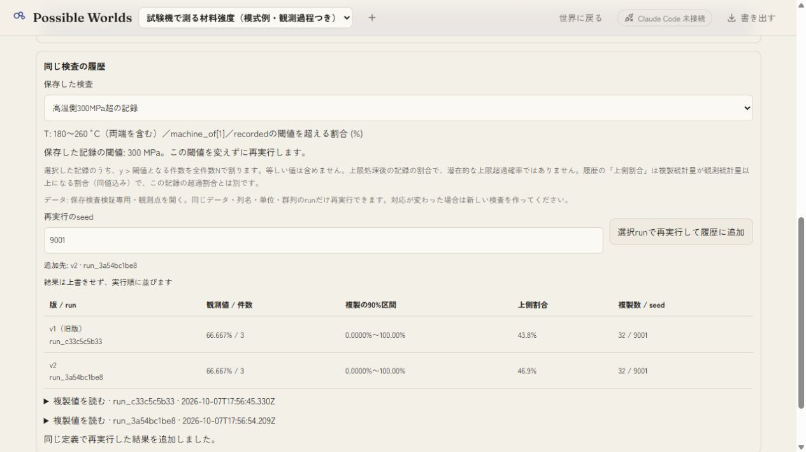
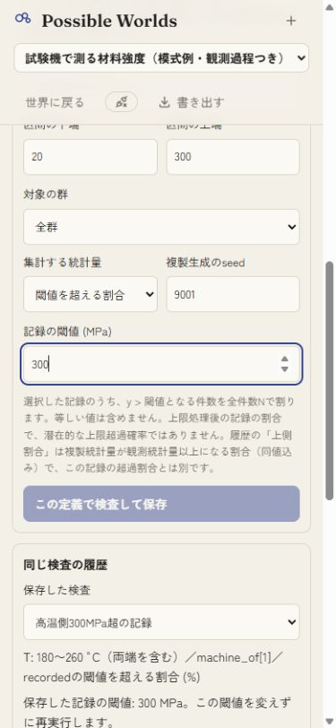
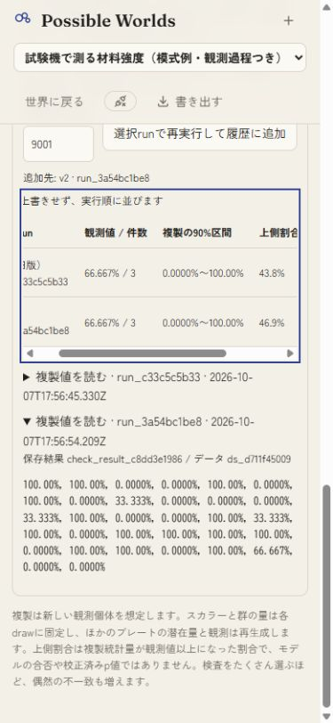

# 閾値を超える記録の割合: 操作検証

2026-10-08 JST。Windowsの専用Store `work/exceedance-qa.json` とloopbackポート5238で検証した。元のClaude作業データは使用していない。ベースコミットは `b3d936494ee90a2805824874ffbcf10920a8a697`、検証ソースは `source-manifest.json` のSHA-256で特定する。

`test/seed-checks-demo.ts` の合成データ、prior生成32drawを使用。実MCMCの結果ではない。

- x=180〜260°C、machine_of[1]、recorded > 300 MPaを保存。閾値未入力では保存不可。3記録中2件で66.667%、複製32件、seed9001。v1の上側割合43.8%、v2で同じ定義を再実行すると46.9%。観測値は同じで、両履歴が残った。
- ブラウザー再読込後、保存済み検査を選び直し、閾値300と両履歴の保持を確認。
- 390×844を要求した狭幅表示（取得画像375×812）で、閾値の単位、説明、入力、ボタンの折返しを確認。履歴表をキーボードで横スクロールし、複製値詳細の開閉と%表示を確認。
- 入力済み閾値300から平均へ切り替え、通常の平均検査を保存できた。閾値欄は非表示となり、値はMPa表示（321.40 / 36件）。世界への戻りも確認し、viewportを復元した。
- 108テスト、型検査、本体build、lab build成功。既知解・等値・空区間・非有限・上限処理後の記録、API拒否時の無変更と保存再読込を含む。

スマホ実機、実データ、実MCMC、Claude側最新ブランチとの統合は未検証。schema@3の既存定義は読み取れるが、この新しい統計量を古いアプリで読めることは保証しない。台帳U16/RP24の全体状態は部分のまま。
