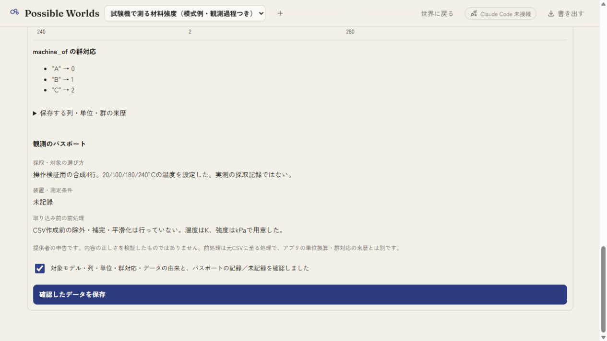
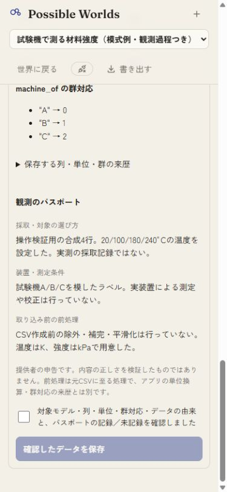
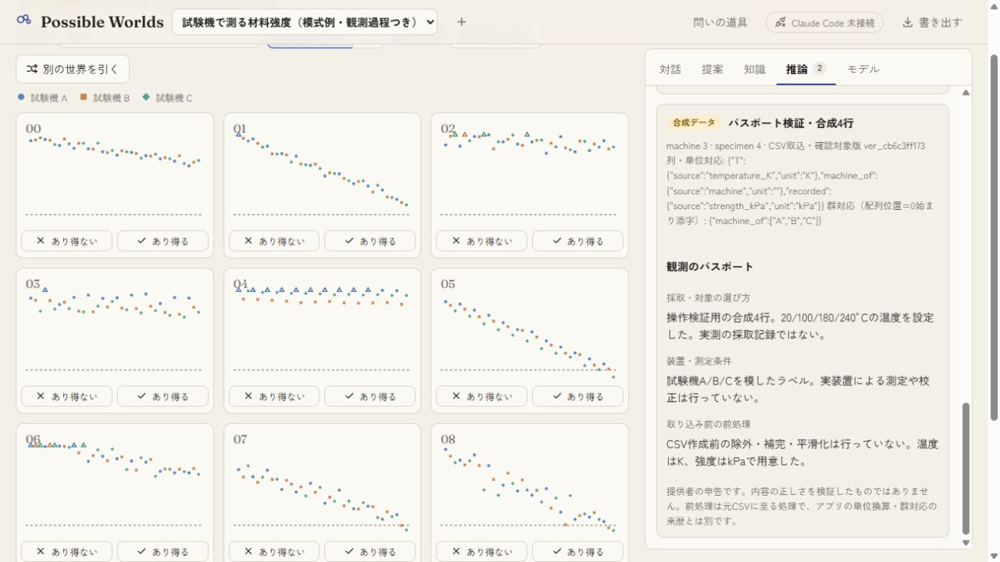
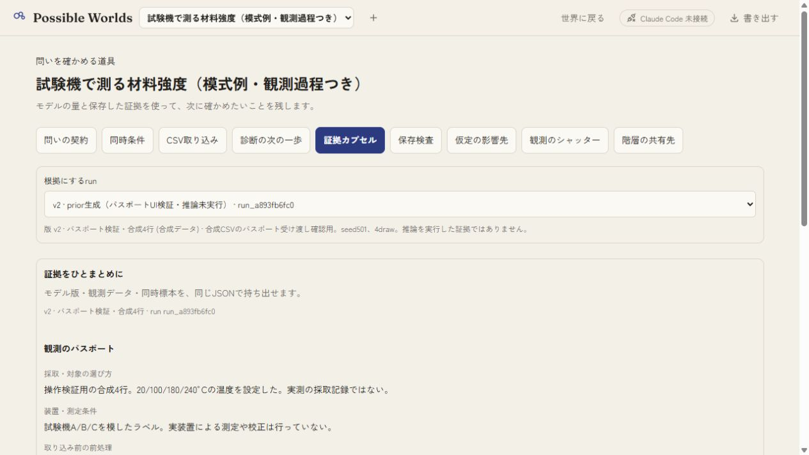
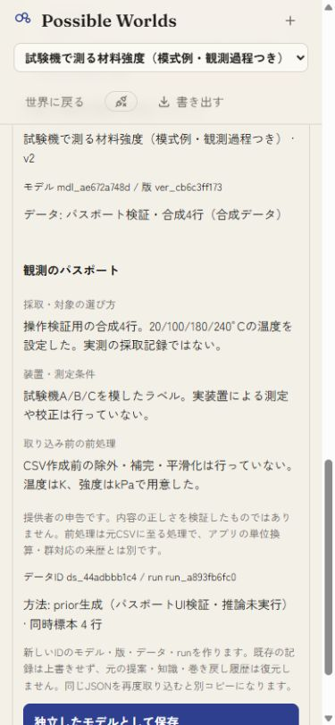
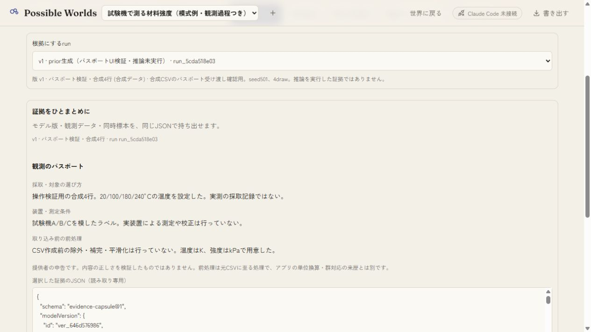

# 観測パスポート: 操作検証

2026-10-08 JST。専用の合成CSV 4行を本体のファイル選択画面から取り込み、観測パスポートのプレビュー・再確認・保存・カプセル保持を検証した。実データは使用していない。専用サーバーはport 5240、保存fixtureはwork/passport-qa.json。viewport指定はdesktop 1265×712、狭幅390×844。保存画像の実寸はdesktop 1265×712px、狭幅375×812px。検証ソースは基点f0419b1の54ファイルを記録した`source-manifest.json`で特定する。

- 合成`input.csv`をファイル選択で読み込み、K→°C、kPa→MPaと群の対応を指定した。instrumentを空にしたプレビューでは未記録と表示し、モデルや群名から装置を補わないことを確認。
- 確認チェック後にinstrumentを編集すると、プレビューと確認が消えた。狭幅で再プレビューした直後は未チェックで、確認チェックを入れ直して保存した。
- Dataset `ds_44adbbb1c4`を保存し、reload後の推論タブのDataset表示でパスポートを確認した。保存済み項目は読取専用。
- seed501で生成した4本のprior drawのrun `run_a893fb6fc0`を使用してカプセルを書き出し、受取検証で項目保持を確認。狭幅で独立したコピーとして保存した。実推論の結果ではない。独立コピーのreload後も3項目を表示した。コピーはmodel mdl_a3173f7f0c / version ver_646d576986 / Dataset ds_efce84852d / run run_5cda518e03。
- 保存状態の照合では旧全記録が不変。追加はモデル1・版1・Dataset2・run2で、コピーのpassport・columns・plates・note・provenance・日時・4draw・診断・method・specが元と一致した。
- 追加4テストは未実装での失敗を確認してから実装。全117テスト、型検査、本体build、ラボbuild成功。

道具は既存の9つのまま。schema@3の任意passport追加で既存Datasetを読めるが、旧アプリで保存すると未知項目として除去される可能性があり、往復保存互換は保証しない。採取・装置・前処理は申告であり、正しさ、代表性、校正、前処理の妥当性を検証したものではない。実推論・実データ・スマホ実機・Claude実環境統合は未確認。U02/P06は部分を維持する。
