# priorを試す: 検証記録

2026-10-08 JST。専用の合成fixture `work/prior-qa.json` を `test/seed-checks-demo.ts` で作成し、Windows localhost:5243で確認した。実データ・実推論は使用しない。基点は `9b5a12ebbd2337b6231c8a73f6805cc1b0dfee8e`。ソースは同梱manifestで特定する。

- 全134テスト・型検査・本体build成功。数値リテラルの対象制約、全11分布の定義域、引数以外の保持、6世界の非有限値、Store/HTTPの不正時無変更・旧基点拒否・採用/見送り/reload/revertを検証した。既存chunkサイズ警告あり。ラボ入力は変えていないため、lab buildは前回の証拠を再利用した。
- 観測例でsigma=0を拒否。resetで元に戻し、同値提案を拒否。sigma=90を同seedでプレビューし、seed・引数の編集でプレビューと提案を無効化した。各世界の基点/候補を隣接させ、観測点も描画する。
- 世界と道具の往復で値・理由・プレビューを保持。世界のrunを旧v1にしても、priorの基点はv2のまま。runによるposteriorと混同しない。
- 観測例s20のsigma=60→90を提案した直後、Proposalの追加以外はファイル内容の各コレクションが一致。通常の差分1行と旧runの予告を確認し採用した。新しい版はv3 `ver_391255bf4c`。
- 採用後も旧v2の下書き90を保持し編集・再提案を停止。明示最新版読込でv3の90へ切り替え、75の案をseed2で比較して狭幅から提案・見送り。reload後も採用値90を保持した。
- 最終状態は版1件とProposal2件（`prp_3b4b765616`採用、`prp_65e0e8dc19`見送り）の追加だけ。既存版・提案・Dataset・run・意図・知識・検査は不変で、対象モデルのcurrentVersionIdだけ更新した。採用版の変更はs20のsigmaのみ。
- 曲線例ではmu=1.79e308を有限だが共通軸で描画不能として拒否し、mu=550では比較成功。曲線例の変更は保存していない。
- デスクトップ1265×712、狭幅390×844指定／画像実寸375×812。値・理由入力、基点/候補の隣接、編集時の提案無効化、見送り操作をピクセルと操作で確認した。下記8画像は提案カードの非有限値ガード追加前の記録。proposal.jpgとnarrow-proposal.jpgは当時の提案操作の証拠として保持し、ほか6画像は変更のない表示境界の証拠を再利用する。

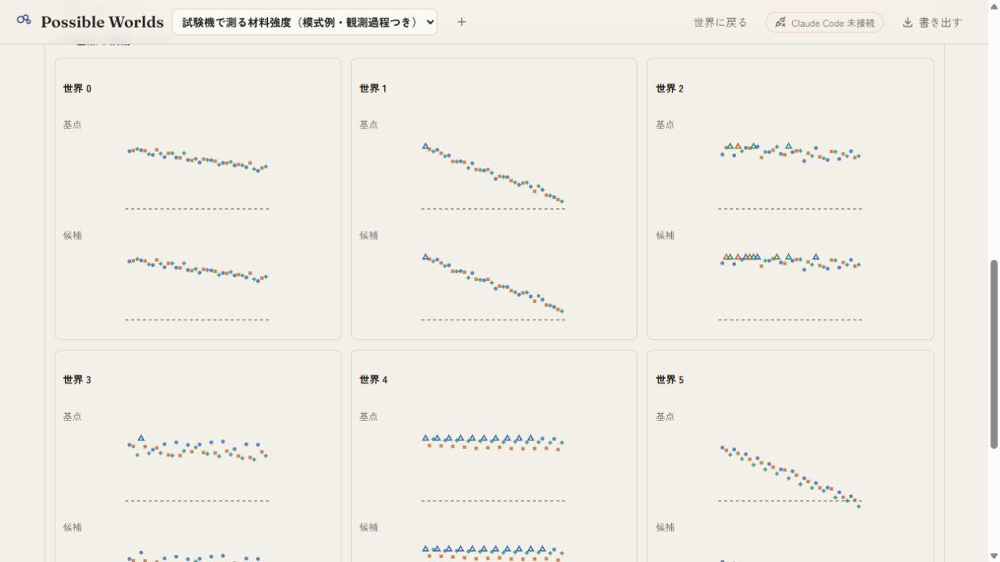

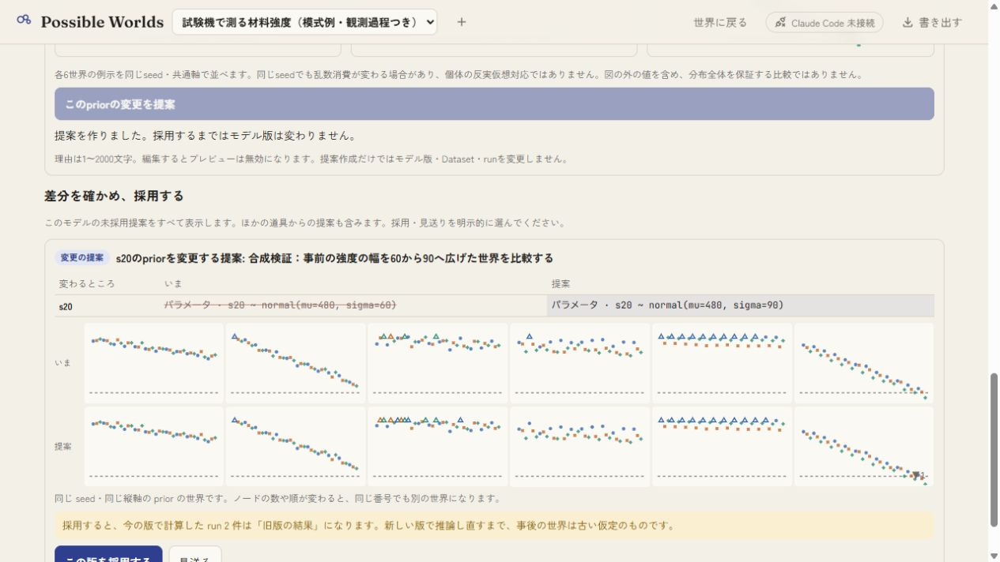

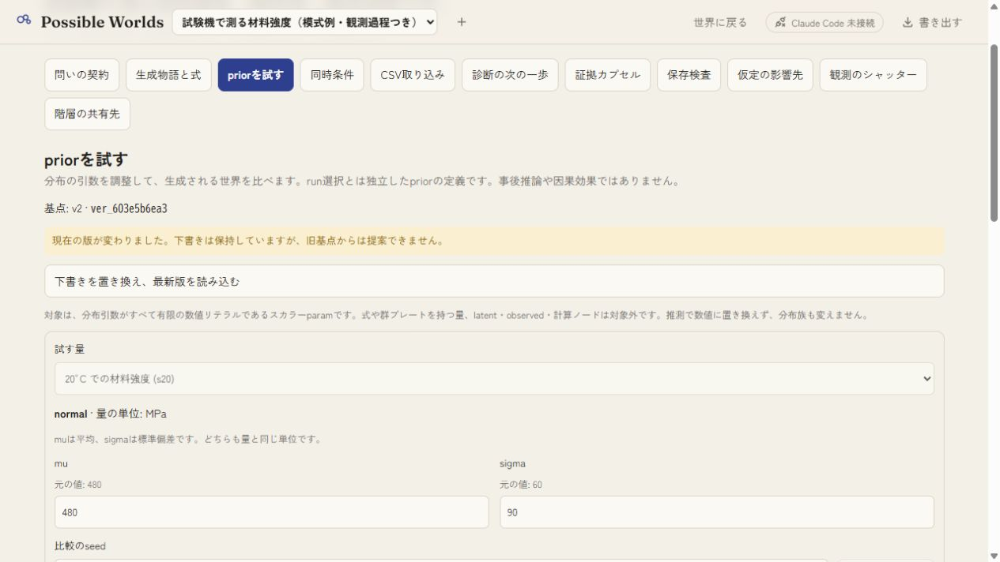

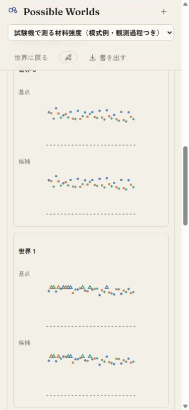

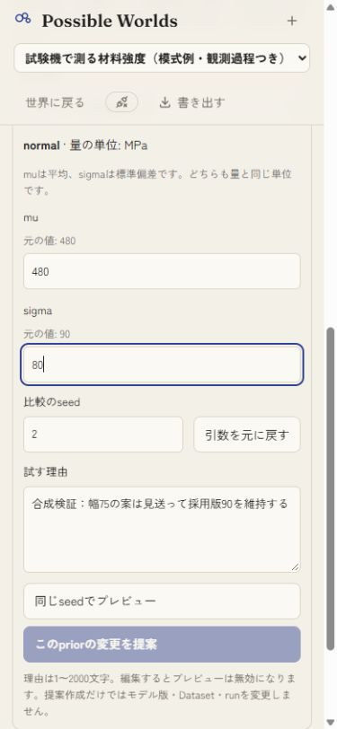

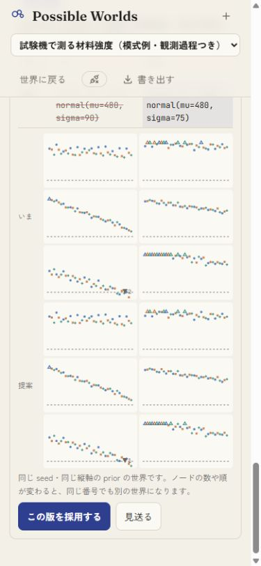

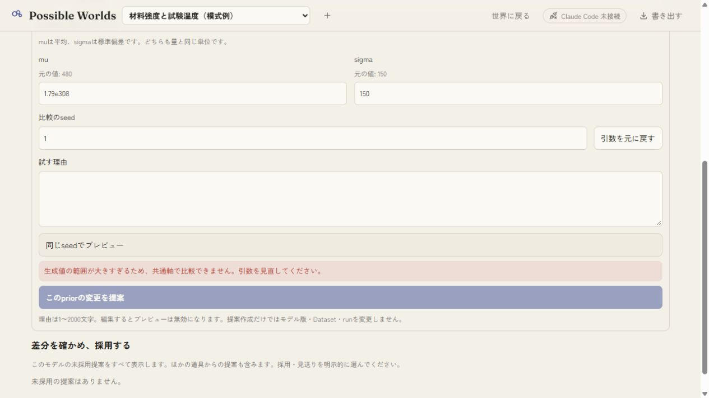

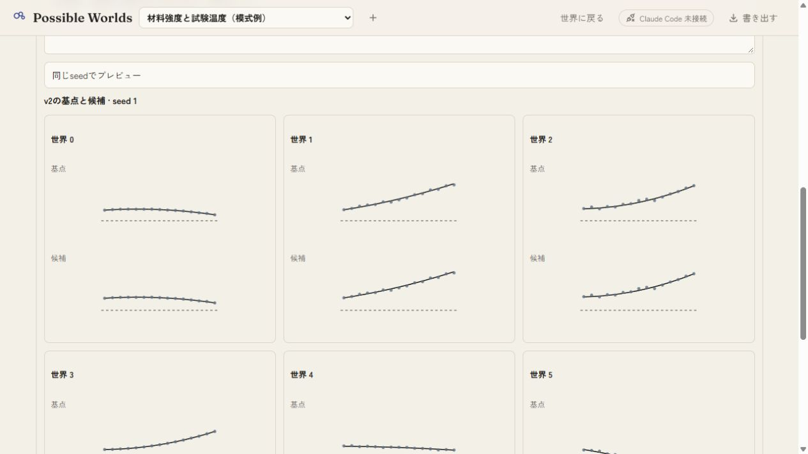

## 提案カードの非有限値ガード

別の合成fixture `work/prior-broken-qa.json` を `test/seed-prior-broken-demo.ts` で作成し、localhost:5244で確認した。曲線例のs20をlognormal(mu=5,sigma=1)とした基点から、mu=700,sigma=20を提案する。seed8の6世界は有限だが、seed1では世界2に非有限値が生じる。

修正前は理由編集でプレビューが消え、提案カードがseed1へ戻ると壊れた世界を図として表示した（RED画像はignored work/prior-broken-red.jpg）。SideBySideで生成値・共通軸を検査する修正後は、seed1で理由を表示し、seed8では図を表示することを実画面で確認した。狭幅でも採用/見送りを操作でき、検証用提案は見送った。

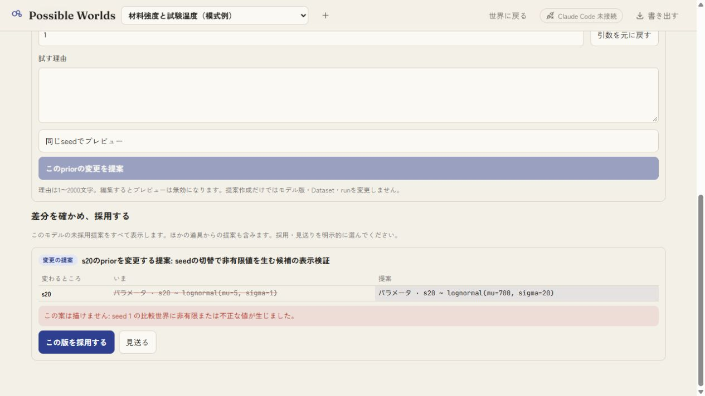

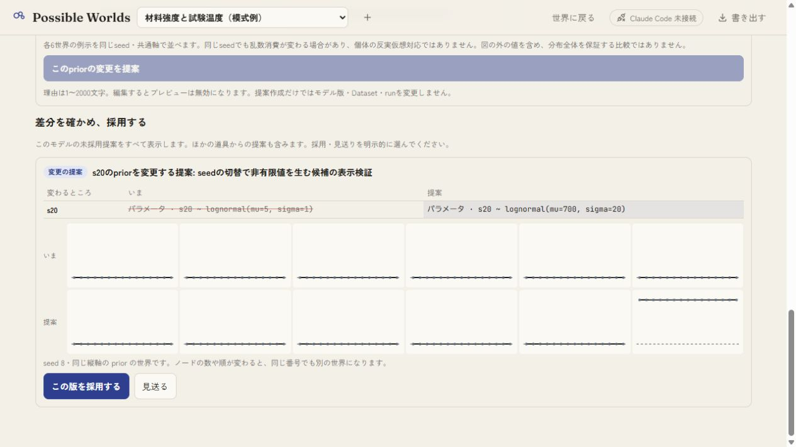

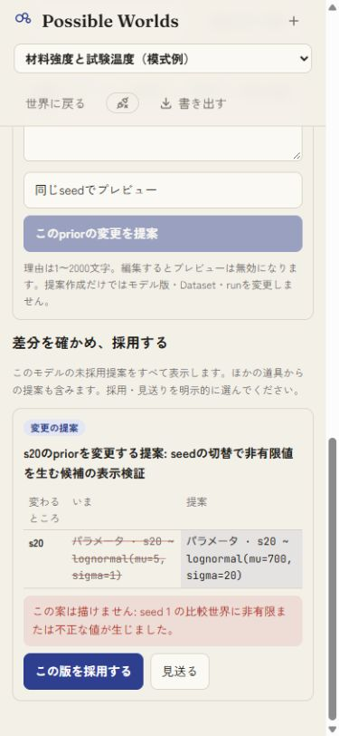

その後、比較seedをプレビューの有無から独立させ、理由編集でもseed入力値を保つ修正を加えた。型検査・buildは成功したが、アプリ専用ブラウザ接続が失われたため、この最後のseed保持操作のGUI再確認は未完了。上記3画像はガード修正後・seed保持修正前の証拠であり、最終ソース全体のGUI確認完了を示さない。manifestは最終ソースを特定する。

保存schema変更なし。人向けAPIを1つ追加し、既存Proposalの採用を使用する。有限の数値引数を持つスカラーparamの同族変更に限定し、族変更・階層・依存式は対象外。6世界の成功は分布全体の保証ではない。実推論・実データ・スマホ実機・Claude実環境統合・利用者評価は未検証。U05部分、U集計5/15/20を維持する。
