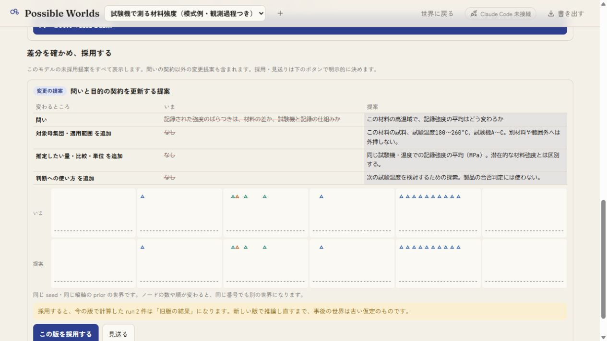
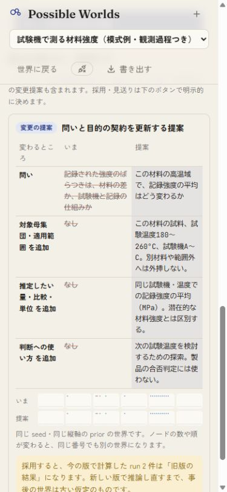
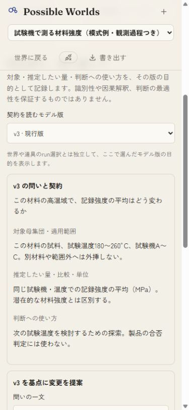
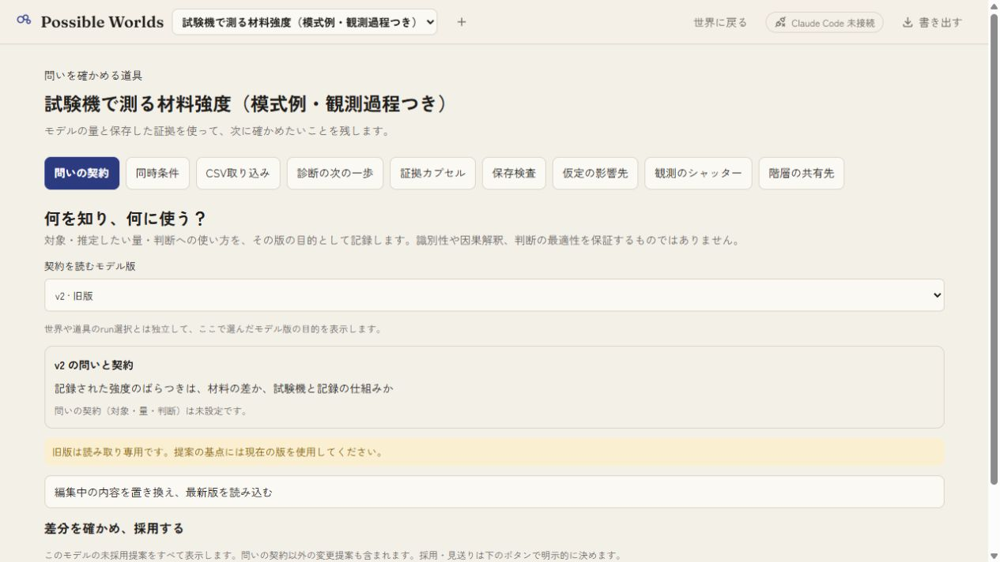
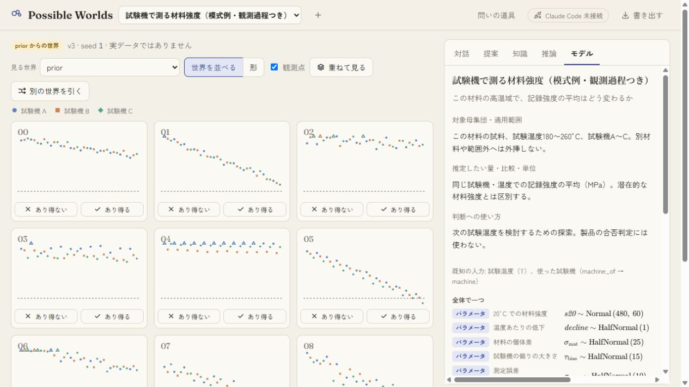

# 問いの契約: 操作検証

2026-10-08 JST。Windowsの専用Store `work/question-qa.json`、loopbackポート5239、本体production buildをアプリ内ブラウザーで検証。ベースは `37885281939d30b60c79f7e698244742bd730498`。検証ソースのSHA-256は `source-manifest.json` に記録する。

`test/seed-checks-demo.ts` による二つの合成モデルを使用。観測過程つきモデルのv2から契約を提案し、v3へ採用した。既存の32draw runはprior生成で、実MCMCではない。

- 未設定の三項目が空欄の間は提案ボタンが無効。問い・対象母集団・推定量・判断用途を入力し、4項目の差分が表示されることを確認した。
- 提案 `prp_6a05c382e7` の作成後、採用前のmodels/versions/Dataset/run/checks/knowledge/intentsが元ファイルと一致。提案だけではモデルが変わらない。
- 狭幅で差分を読み、同じ画面の「この版を採用する」でv3 `ver_32c6702823` を作成。旧v2の契約は未設定のまま。下書きは残り、古い基点での送信は無効となった。最新版を明示的に読み込むと採用済み契約が表示された。
- 判断用途だけの次の提案 `prp_fd191faa0b` は差分1行。見送って再読込し、最初に採用したv3の契約が保持されることを確認した。
- v2を選ぶと読み取り専用となり、入力フォームを出さない。最新版へ戻り、世界との往復、モデル欄の契約表示を確認。既存run選択肢は旧版と表示された。
- 採用・見送り後も全既存版とDataset/run/checks/checkResults/knowledge/intentsは元ファイルと一致。
- 全113テスト、型検査、本体build、ラボbuild成功。入力/旧版/同一内容/余計なフィールドの拒否時不変、採用・見送り・revert・再読込・overview・カプセル独立取込の保持を含む。「なし」「未設定」という実入力も、未設定との差分から消えない。

デスクトップ画像1265×712。狭幅は390×844指定、取得画像375×812。長文の折返し、操作領域、差分表、入力、選択と戻る操作を確認し、終了時にviewportを復元した。

U01は部分のまま。推定量の式、母集団の機械検証、最適な判断の計算、利用者評価は未対応。スマホ実機・Claude最新ブランチとの統合も未検証。schema@3への任意項目追加で既存ファイルを読めるが、旧アプリでの再保存時にこの新項目を保持できる保証はない。
