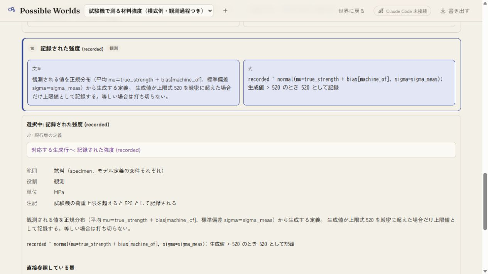
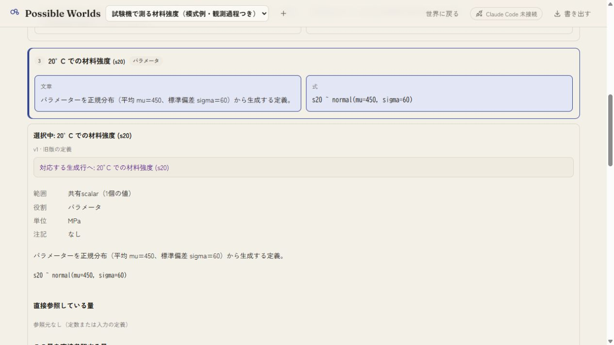
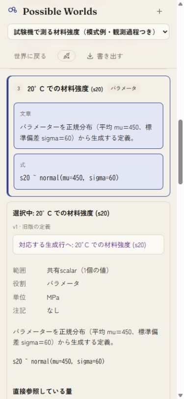
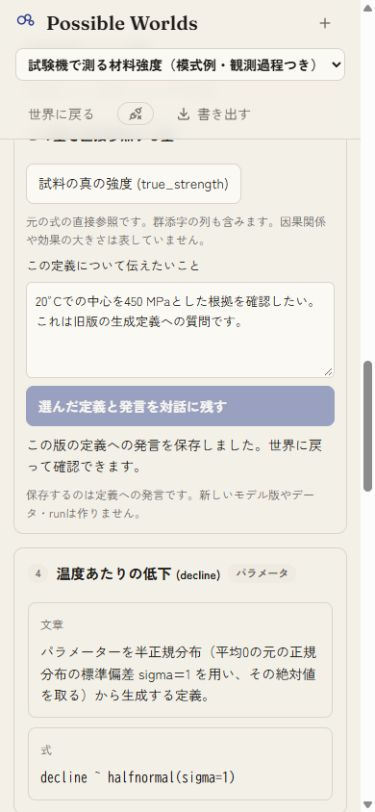
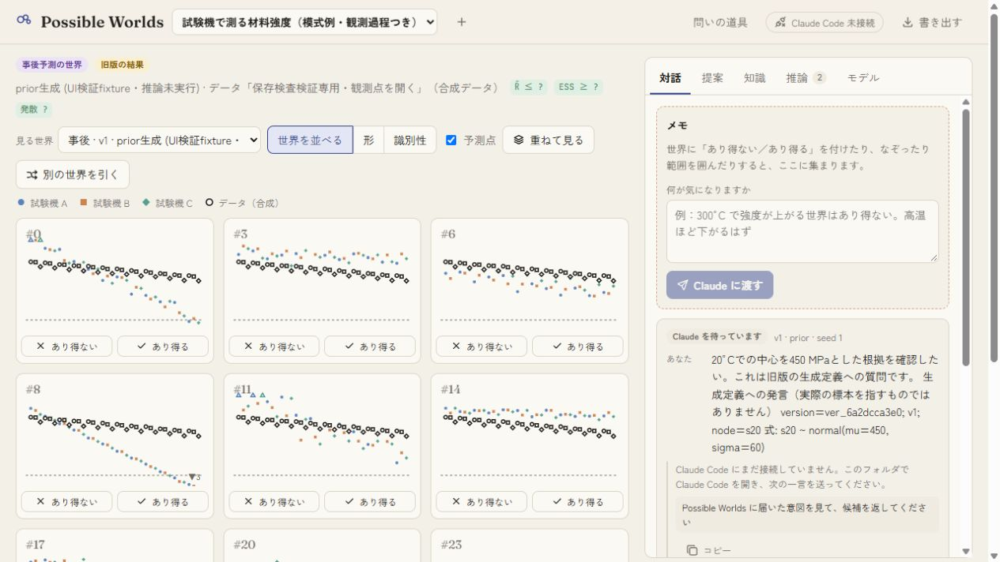
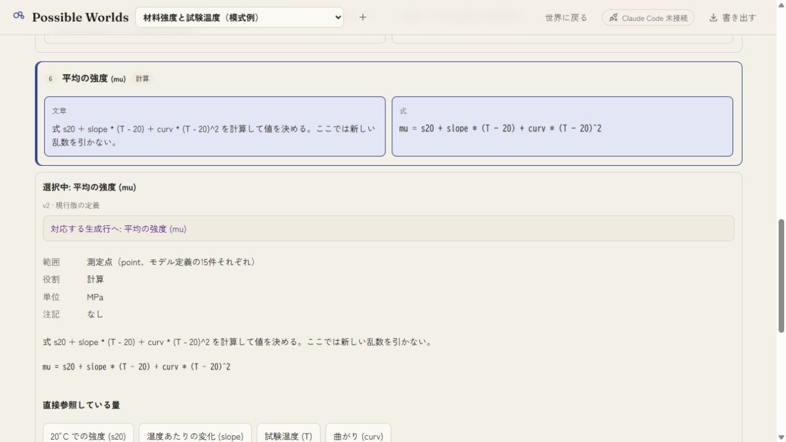
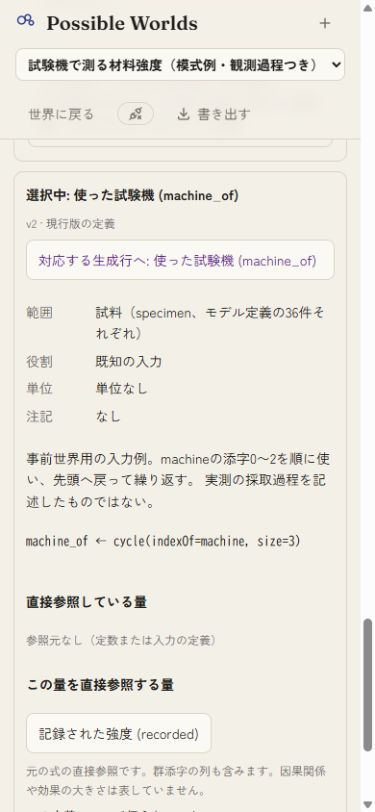

# 生成物語と式: 操作検証

2026-10-08 JST。専用サーバーport 5241、seedChecksDemoで生成した合成fixture `work/story-qa.json`を使用。viewport指定はdesktop 1265×712、狭幅390×844、保存画像はそれぞれ1265×712px、375×812px。ソースは基点`c8b0b78035d00580cc954f8d7baac759de96515d`と`source-manifest.json`の57ファイルで特定する。画像7枚はすべて最終build（index-CIOBCbLa.js）で記録した。

- 追加4テストは未実装でのRED確認後に実装。全121テスト・型検査・本体build成功。両例・全11分布の引数・AST直接参照・入力・観測上限を検証した。既存のchunkサイズ警告は残る。ラボ入力は不変で、今回はラボbuildを再実行していない。
- 観測例のrecordedを式と文章から選択し、両側の選択が同期することを確認。machine_ofからrecordedへの直接参照を辿り、詳細の表示位置とpreventScrollによるフォーカス移動を確認した。明示アンカーも操作し、狭幅で見出しが隠れる問題を修正後に再確認した。
- 世界と道具の往復で選択と編集中の発言を保持。runをv1に切り替えても物語はv2を保持し、明示的に物語の版を変更すると発言を空にしてTを選択した。s20のmuは旧v1の450、新v2の480を表示。曲線例でも定義を確認した。
- 旧v1へ発言を保存し、reload後の対話で版参照付きの本文を再表示した。ファイル照合では旧全記録が不変で、追加はintent `int_fb16a1bec3`だけ。sceneはversion `ver_6a2dcca3e0`、runはnull、seedは1、marksは空配列。本文にs20のnormal(mu450 sigma60)を保持した。

schema/API変更なし、道具は10個。物語は版の定義の読み替えで、実際の生成履歴・因果の証明・posterior標本の生成手順ではない。自由文生成や文章編集から式を変更する機能は対象外。利用者評価・Claude実環境統合・スマホ実機は未検証で、U03は部分を維持する。
