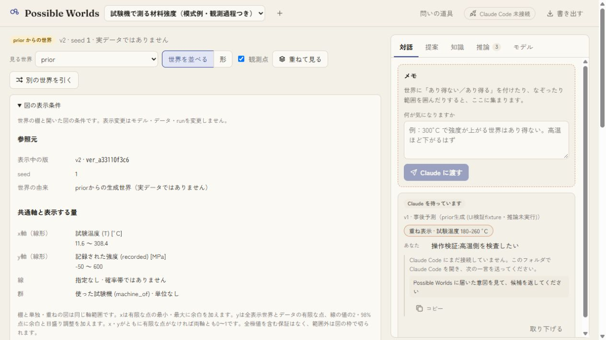
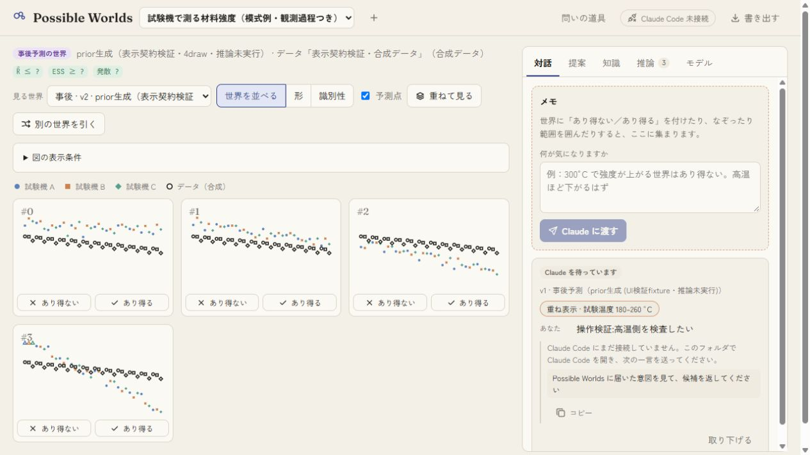
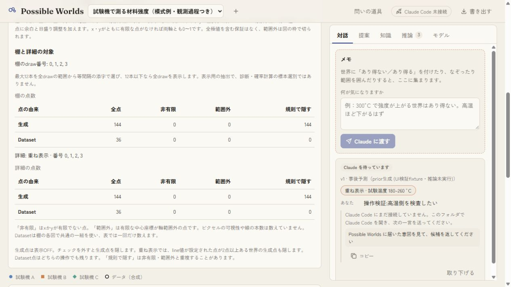
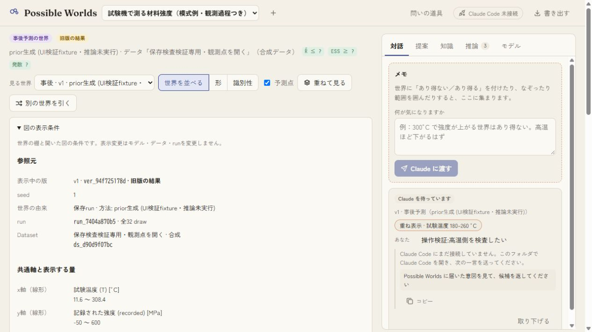
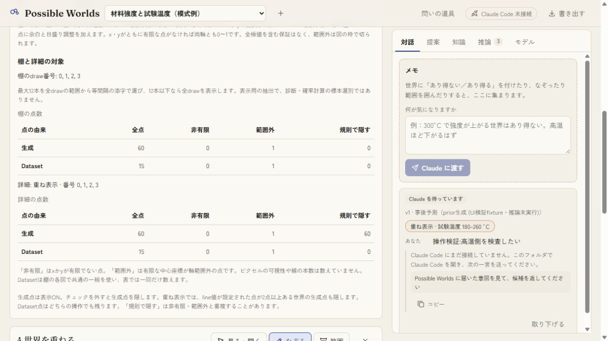
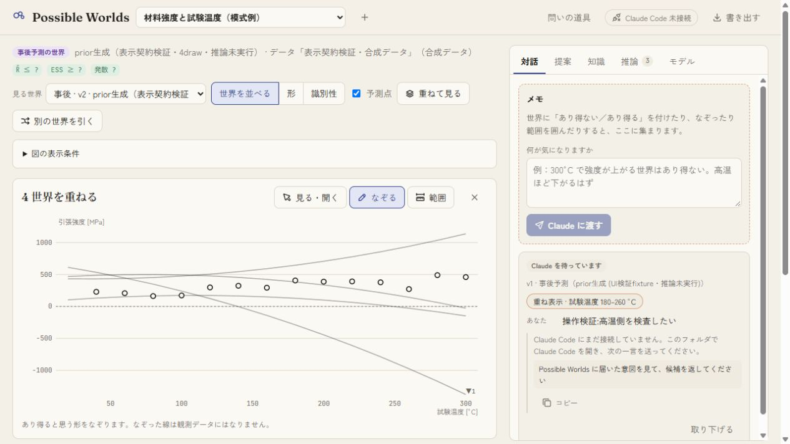
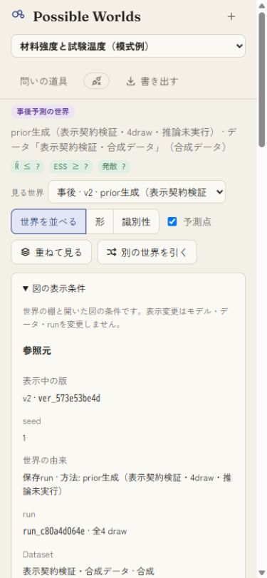
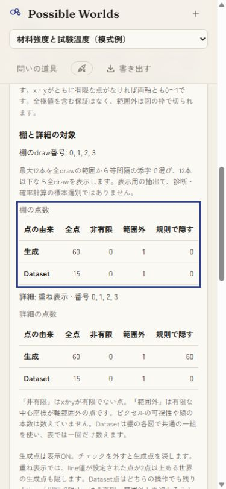

# 図の表示条件: 操作検証

2026-10-08 JST。専用サーバーport 5242と合成fixture `work/view-qa.json`で検証した。ソースは基点`52b9c5387cecf1e4692b0f7d584b2b5dfad9d816`と`source-manifest.json`の61ファイルで特定する。狭幅画像は375×812px。

- 全126テスト・型検査・本体build成功。小標本の全draw、表示抽出順、軸外・境界・非有限座標、点表示規則、棚/詳細の参照範囲を検証した。
- 観測例のpriorは生成432点。4drawのrunは#0〜#3を欠落なく棚へ出し、棚144点・単独36点を表示した。点OFFでは棚/重ねの生成144点を隠し、Dataset36点は残った。
- 旧v1の32drawから選んだ番号は0,3,6,8,11,14,17,20,23,25,28,31。旧版とrun参照を表示し、形・識別性のレンズでは図の表示条件を出さないことを確認した。
- 曲線4drawでは棚の生成60点中1点、Dataset15点中1点が軸外。重ねでは生成60点を隠すが、棚の非表示は0点。実際の線とDatasetの描画も確認した。範囲外は有限な点の中心座標の判定で、ピクセル可視性ではない。
- 狭幅で参照の折返し、表の全列表示、キーボードフォーカスを確認した。表の横スクロールは不要だった。詳細を閉じて4drawの棚へ戻れることも確認した。
- GUI前後のfixtureと退避したbeforeを比較し、ファイル内容の完全一致を確認。表示操作では保存状態を変えていない。

保存形式・API変更なし、道具は10個のまま。U36を部分に維持し、U39は今回の契約テストの範囲で部分へ変更した。軸は全極値を含む保証がなく、線は確率帯ではない。任意描画・全レンズ・ピクセル可視性を網羅する検証ではない。実推論・スマホ実機は未検証。
